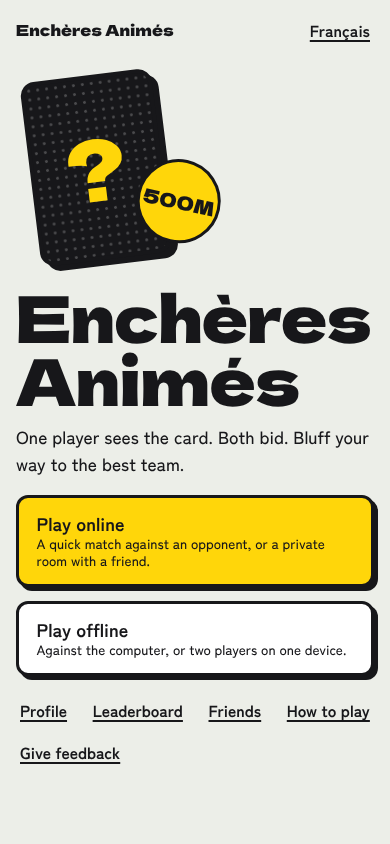
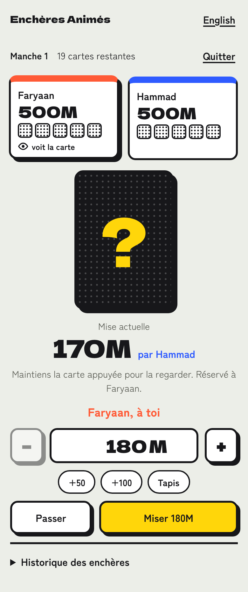
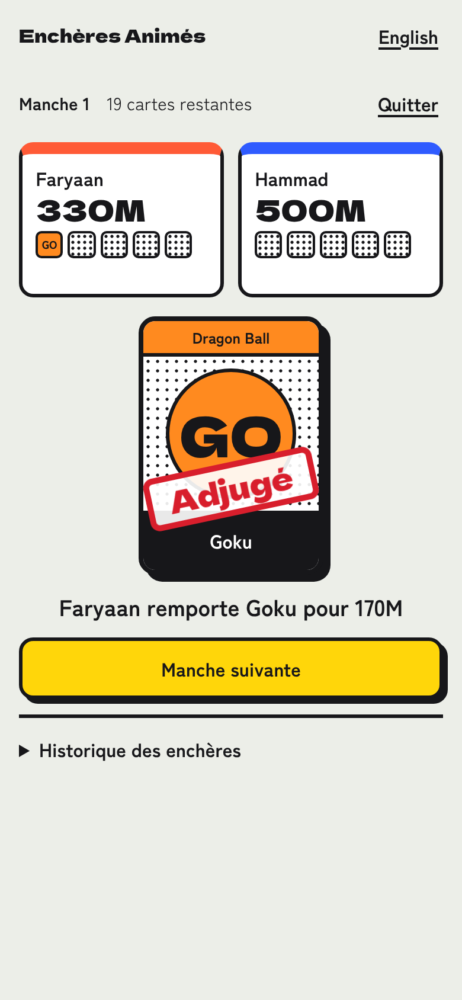
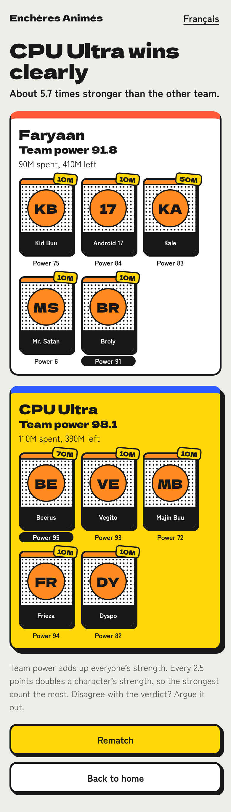
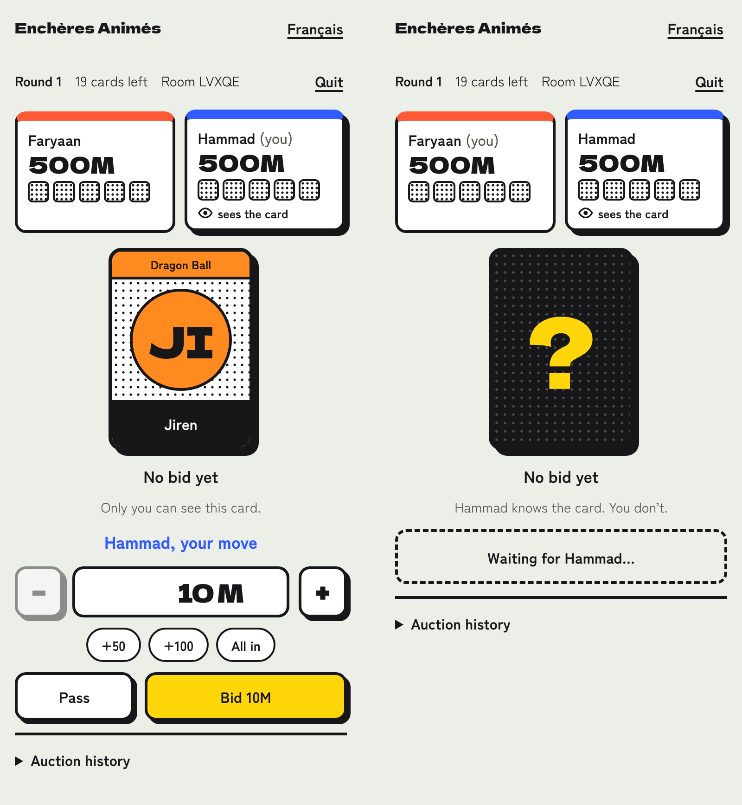

# Enchères Animés

A two-player bluffing game for anime fans, playable in the browser. One player draws a
character card and is the only one who sees it; both players then bid for it with a
fictional budget. Bluff the price up on a weak card, or stay quiet and take a strong one
for almost nothing. When the teams are complete, argue about who built the better one.

The format comes from the "enchères animés" videos popular on French TikTok. This project
turns it into a web app with three ways to play:

- **One device** — two players pass a single phone. The card stays face down until the
  drawer presses and holds it.
- **Against the computer** — two difficulty levels. The computer only knows what a player
  in its seat would know.
- **Online** — a quick match against whoever else is looking for a game, or a private room
  that a friend joins with a five-character code. The hidden card never leaves the server
  unless a player is allowed to see it.

The interface is available in **French and English**.

| Home | Bidding | Reveal | Final teams |
| --- | --- | --- | --- |
|  |  |  |  |

Online, each phone only receives what its player may see. Left: the drawer. Right: the
rival, during the same auction.



## Features

- Hidden-card auction with turn-based bidding, final passes and automatic resolution
- Seven universes and 326 characters, or everything mixed together; rosters are sized to
  each cast and mix top tiers, fan favourites, mid-tier and weak cards
- A power rating and a one-line reason for every character
  ([docs/POWER_RATINGS.md](docs/POWER_RATINGS.md))
- A verdict at the end of every game: team power is computed from the ratings with a
  top-heavy formula, so one great character outweighs several average ones
- A computer opponent in two levels: a rule-based player, and one that counts cards and
  plays out the rest of the game before every bid
- Adjustable budget (300M, 500M, 1 Md) and team size (3 to 7)
- Same-device games are saved after every move and can be resumed
- Private online rooms with a shareable link, rematches and automatic reconnection; both
  players always see each result, even if the other moves on first
- Quick matches: a matchmaking queue, a 60-second turn clock, forfeits, and an opponent
  played by the database itself when nobody else is looking for a game, with a strength
  that follows the player's trophies
- Saved accounts: a recovery code opens a profile on another device; Google sign-in is
  built and waits for the provider to be configured
- Ranked play in eight modes (each universe, or all mixed): trophies won and lost by
  rank difference, six leagues, pairing with players of a similar level, and the winner
  decided by the server
- An overall score across all modes, in which the mixed mode counts double, and a
  monthly reset of the Legend league
- Player profiles with statistics, badges, an avatar and a country; leaderboards for the
  overall score and for each mode, worldwide, by country or among friends
- Friends by player tag, and invitations to private rooms
- Every finished online game is recorded with its full action log
- A feedback form for ideas, bugs and rating disputes
- French and English, remembered per device
- Designed for phones first, usable on desktop, keyboard accessible

## How the hidden card stays hidden

In online play a cheater could open the browser's developer tools, so the browser must
never receive anything it is not allowed to show. The app therefore never reads a database
table. All game state lives in a Postgres schema the API does not expose, and the only way
in is five SQL functions. Each one identifies the caller from a secret token and returns a
view of the room in which the card is `null` unless that player is the drawer or the round
is over. The deck order is shuffled on the server and is never sent to anyone.

The same rules exist twice: in TypeScript for same-device play, and in PL/pgSQL for online
play. A test replays random games through both and compares every intermediate state, so
the two implementations cannot drift apart unnoticed.

More detail: [docs/ARCHITECTURE.md](docs/ARCHITECTURE.md).

## Tech stack

| Layer | Choice |
| --- | --- |
| UI | React 18, TypeScript (strict), plain CSS |
| Build | Vite |
| Online backend | Supabase: Postgres functions (PL/pgSQL) and Realtime broadcast |
| Tests | Vitest; PGlite (Postgres compiled to WebAssembly) runs the real SQL migration |
| CI | GitHub Actions: type check, tests, production build |
| Hosting | Netlify (static site) |

## Getting started

Requires Node.js 20 or newer.

```bash
npm install
npm run dev        # http://localhost:5173
```

Same-device play works immediately. Online play uses the Supabase project configured in
`.env`; to use your own, see [docs/DEPLOYMENT.md](docs/DEPLOYMENT.md).

| Command | What it does |
| --- | --- |
| `npm run dev` | Development server with hot reload |
| `npm test` | Runs the 179 unit, database, parity, ranking, account, mode and bot tests |
| `npm run test:e2e` | Plays private rooms, quick matches, modes, friends and the account screens in headless browser sessions (needs Chrome) |
| `npm run ratings` | Rebuilds the power-ratings document, the CSV and the database seed (`0004`) from `src/data/rosters.json` |
| `npm run typecheck` | TypeScript in strict mode, no output |
| `npm run build` | Type check, then production build into `dist/` |
| `npm run preview` | Serves the production build locally |

## Project structure

```text
src/
  game/            Pure auction engine, team verdict and their types (no React, no I/O)
  bot/             Computer opponent and the simulator used to measure it
  data/            Universes, characters and power ratings (`rosters.json`)
  local/           Games on this device (shared screen or against the computer)
  match/           Quick-match settings
  online/          Supabase client, API calls and the room synchronisation hook
  components/      Board, cards, bidding controls, scoreboard, final screen
  screens/         Home, setup, online lobby, rules
  i18n/            French and English strings
supabase/
  migrations/      The database: tables, rules, matchmaking and the API functions
  tests/           Security, matchmaking and engine/SQL parity tests
e2e/               Two-browser end-to-end test of online play
docs/              Architecture, rules, deployment, portfolio notes
```

## Documentation

- [docs/HANDOFF.md](docs/HANDOFF.md): start here to continue the project. Where everything
  lives, how to change it safely, what is done and what is open
- [Game rules](docs/GAME_RULES.md) (English and French)
- [Power ratings](docs/POWER_RATINGS.md): the scale and every character's rating
- [Architecture](docs/ARCHITECTURE.md)
- [Deployment](docs/DEPLOYMENT.md)
- [Portfolio notes](docs/PORTFOLIO.md): project summary and CV bullet points

## Card pictures

No artwork ships with this project. Cards are drawn by the app from the character's name
and universe colour. To show a picture on a card, add an image you are allowed to use to
`src/assets/cards/`, named after the character id (see
[src/assets/cards/README.md](src/assets/cards/README.md)).

## Roadmap

- "Undercover" and dice variants seen in the French videos
- Spectators and audience voting on the final teams

## Licence

All rights reserved; see [LICENSE](LICENSE). The code is public to be read, not reused.

## Notice

This is a non-commercial fan project. Character and series names belong to their
respective owners and are used only to identify the characters in the game.
